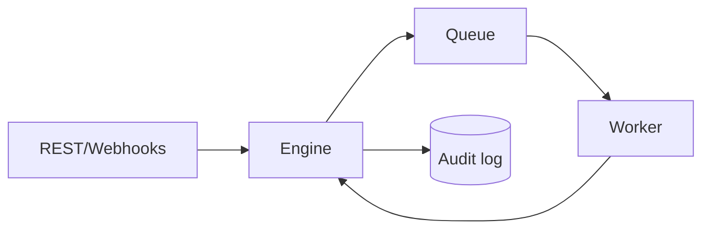

# forgeflow
Durable-workflow control-plane MVP in Rust. The current dependency-free core demonstrates idempotent submission, explicit job states, bounded retries, claiming, and an audit trail.

Run `cargo test` and `cargo run`. PostgreSQL persistence, Axum APIs, RBAC, scheduling, OpenTelemetry, worker leases, and the Angular console are the next production milestones.
