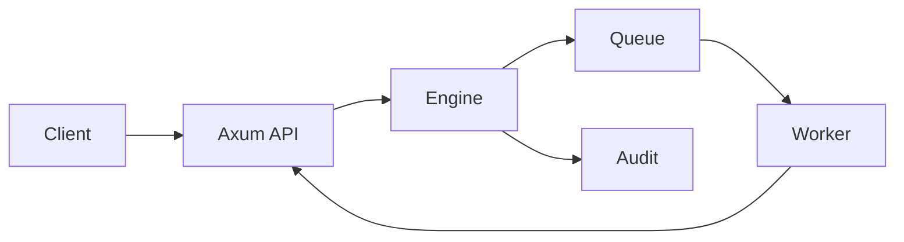

# forgeflow

A compact job-control plane in Rust.

Jobs can be submitted idempotently, scheduled, claimed with expiring leases, retried, cancelled, and recovered after a worker disappears. Claim tokens fence stale workers, roles keep operations separate, and every state change is added to the audit trail.

The Axum server exposes health checks plus job, claim, completion, cancellation, and audit endpoints under `/v1`.



```sh
cargo test
cargo run
```

The included adapter keeps state in memory. The engine supplies time explicitly so scheduling, retries, and lease recovery stay deterministic in tests.
