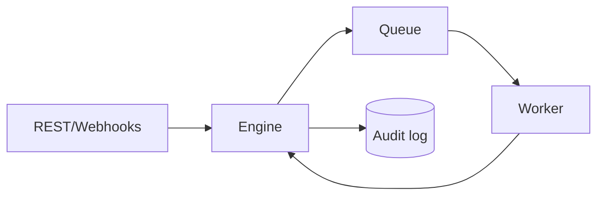

# forgeflow
Durable-workflow control-plane core in Rust. The dependency-light engine provides idempotent submission, scheduled delivery, explicit job states, bounded retries, worker leases, heartbeats, stale-lease recovery, claim tokens, least-privilege roles, and an audit trail.

Run `cargo test` and `cargo run`, then use the health, job, worker-claim, completion, cancellation, and audit endpoints under `/v1`. Time is supplied explicitly to the domain core, making scheduling and recovery deterministic under test. The in-memory adapter keeps the example easy to run; the engine's lease and claim-token boundaries are designed so a durable store can replace it without changing worker semantics.
