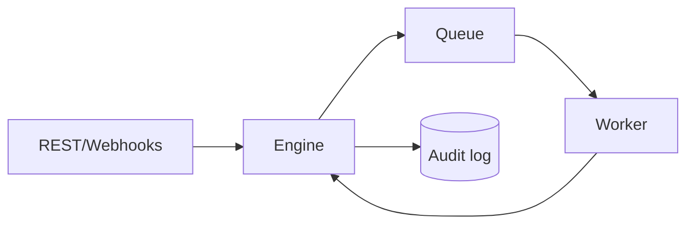

# forgeflow
Durable-workflow control-plane core in Rust. The dependency-light engine provides idempotent submission, scheduled delivery, explicit job states, bounded retries, worker leases, heartbeats, stale-lease recovery, claim tokens, least-privilege roles, and an audit trail.

Run `cargo test` and `cargo run`. Time is supplied explicitly to the domain core, which makes scheduling and recovery behavior deterministic under test. PostgreSQL persistence, Axum APIs, OpenTelemetry, signed webhooks, and the Angular console remain the next integration milestones.
